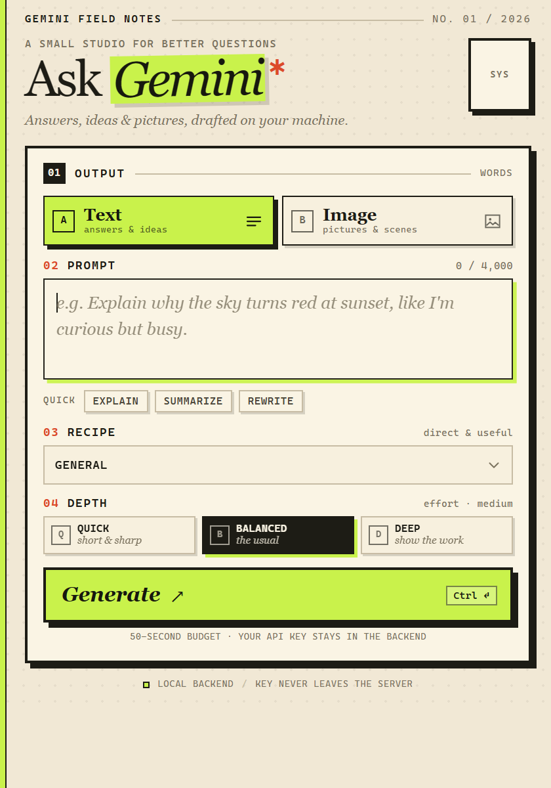

# Gemini AI Chrome Extension

A working Manifest V3 Chrome extension and local Node.js/Express backend that send prompts to Google Gemini. The Gemini API key lives **only** in `backend/.env`; it is never shipped in the extension.

The popup is designed as a small editorial studio: warm paper, ink borders, hard offset shadows, chartreuse accents, serif display type, and monospaced field labels. It does not use a generic gradient-card layout.



<sub>Actual 420 × 600 popup in light theme. Full-page previews: [light](docs/popup-preview-light.png) · [dark](docs/popup-preview-dark.png).</sub>

## Features

- **Editorial "field notes" interface** with index numbers, stamped quick actions, depth cards, and a ruled-paper result sheet
- **Light / dark / system themes**, remembered in `localStorage` and applied before first paint by `theme-init.js`
- **Text and image modes** — switch the whole studio between answers and generated pictures (successful image output requires image quota)
- **Five response recipes**: General, Explain, Summarize, Code, Creative
- **Three response depths**: Quick, Balanced, Deep, mapping to 512 / 2,048 / 8,192 output tokens and Gemini `thinking_level` `low` / `medium` / `high`
- **Quick actions** — Explain, Summarize, and Rewrite wrap the current text and generate immediately
- **Copy and download** — answers as `.txt`, images as `.png`, using Blob URLs and no extra Chrome permissions
- **XSS-safe output** — model text is always inserted with `textContent`, never `innerHTML`
- `Ctrl` / `Cmd` + `Enter` shortcut, loading state, duplicate-submit prevention, reduced-motion support
- Express backend with:
  - `GET /api/health`
  - `POST /api/generate` text proxy with template and depth options
  - `POST /api/generate-image` image generation (`/api/image` remains as an alias)
  - Prompt validation and explicit option validation
  - Per-IP rate limiting (30-second window; tighter limit for images)
  - CORS restricted to Chrome extension origins plus an optional allowlist
  - Automatic retry for transient Gemini 5xx errors
  - A 50-second maximum request budget, safe error mapping, and API-key redaction
- Official [`@google/genai`](https://www.npmjs.com/package/@google/genai) SDK and Gemini Interactions API
- Gemini text requests use `store: false`, so the Interactions API does not retain conversation state
- No frontend build step and no unnecessary runtime dependencies

## Project structure

```text
AI-Chrome-Extension/
├── extension/
│   ├── manifest.json        # Manifest V3 configuration
│   ├── popup.html           # Field-notes popup markup
│   ├── popup.css            # Editorial light + dark styling
│   ├── popup.js             # Client state, requests, theme, downloads
│   ├── theme-init.js        # Pre-paint theme resolver
│   └── icons/               # Toolbar icons
├── backend/
│   ├── server.js            # Express server + Gemini integration
│   ├── package.json
│   ├── package-lock.json
│   ├── .env                 # Your local secrets (ignored by Git)
│   ├── .env.example         # Configuration template
│   ├── test/smoke.test.js   # Backend API tests (node:test)
│   └── test/rate-limit.test.js
├── docs/
│   ├── popup-preview.png
│   ├── popup-preview-light.png
│   └── popup-preview-dark.png
├── .gitignore
└── README.md
```

## Prerequisites

- **Node.js 20 or newer** (verified with Node.js 24.21.0 and npm 11.19.0)
- **Google Chrome** with Manifest V3 support
- A **Gemini API key** from [Google AI Studio](https://aistudio.google.com/apikey)
- Image generation additionally requires Gemini **image quota** for your account; see [Verification status](#verification-status)

## 1. Configure and start the backend

```bash
cd AI-Chrome-Extension/backend
npm install
```

Open `backend/.env` and replace the placeholder key:

```env
GEMINI_API_KEY=your_gemini_api_key_here
```

The project ships with these defaults (also documented in `.env.example`):

```env
PORT=3000
HOST=127.0.0.1
GEMINI_MODEL=gemini-3.6-flash
GEMINI_IMAGE_MODEL=gemini-3.1-flash-image
MAX_PROMPT_LENGTH=4000
IMAGE_MAX_PROMPT_LENGTH=1000
REQUEST_TIMEOUT_MS=50000
GEMINI_MAX_ATTEMPTS=2
RATE_LIMIT_MAX=15
RATE_LIMIT_WINDOW_MS=30000
RATE_LIMIT_IMAGE_MAX=6
ALLOWED_ORIGINS=
```

Start the server:

```bash
npm start
```

Expected startup output:

```text
Backend listening on http://127.0.0.1:3000
Health check: http://127.0.0.1:3000/api/health
Gemini model: gemini-3.6-flash
Gemini image model: gemini-3.1-flash-image
```

Verify the health endpoint:

```powershell
Invoke-RestMethod http://127.0.0.1:3000/api/health
```

```json
{
  "status": "ok",
  "service": "ai-chrome-extension-backend",
  "timestamp": "2026-10-30T07:22:01.462Z"
}
```

For automatic restarts during development:

```bash
npm run dev
```

> If the server starts without a key, `/api/health` still works and both generation endpoints return `503 AI_NOT_CONFIGURED`. This keeps the server diagnosable during setup.

## 2. Load the extension in Chrome

1. Open `chrome://extensions/`.
2. Enable **Developer mode**.
3. Click **Load unpacked**.
4. Select the `AI-Chrome-Extension/extension` folder (the one containing `manifest.json`).
5. Pin **Gemini AI Assistant** if desired, then open it from the toolbar.

The extension requests only host access to `http://127.0.0.1:3000/*` and `http://localhost:3000/*`. It requests no other Chrome permissions.

## 3. Use it

1. Keep the backend running.
2. Open the popup.
3. Choose **Text** or **Image**.
4. Type a prompt.
5. Pick a recipe and depth for text, or use a stamped quick action:
   - **Explain** switches to the Explain recipe and asks for steps plus a takeaway.
   - **Summarize** switches to the Summarize recipe and asks for key points.
   - **Rewrite** asks for a clean rewrite without changing the selected recipe.
6. Click **Generate** (or press `Ctrl` / `Cmd` + `Enter`).
7. Read the ruled-paper result, then **Copy** or **Save** it.
8. Click the theme block to cycle **system → light → dark**. The choice persists.

Image mode uses the same prompt field with a 1,000-character limit, hides the text-only recipe/depth controls, shows a framed preview, and saves the returned image as a PNG.

## Verification status

Tested on **2026-10-30** with Chrome for Testing 156 and Node.js 24:

- **23 / 23 backend tests pass** (`npm test`).
- The Chrome popup was driven with Puppeteer using request interception (no second server on port 3000) to verify:
  - initial field-notes layout and state
  - empty-prompt validation and duplicate-submit prevention
  - loading state and disabled controls
  - XSS-safe response rendering
  - template, depth, quick-action, and preference persistence
  - theme cycling and persistence across reload
  - image preview and PNG download wiring
  - text download wiring
  - backend error, rate-limit error, and image error states
  - no uncaught page errors
- A **live text generation** was verified through the real backend and the real popup with `gemini-3.6-flash` (about 2.2 seconds for a short reply).
- **Image generation is not claimed as successfully verified.** Requests reached Gemini and the request shape was accepted, but this API key received `429` quota responses from both `gemini-3.1-flash-image` and `gemini-2.5-flash-image`. The popup and backend correctly surface the safe quota message. Successful image output requires image-capable quota for your key.
- The backend hard-caps the total Gemini time budget at **50 seconds**; the extension aborts at 70 seconds so the UI can show a useful timeout message.

The screenshots use mock responses so no live content or API key appears in them.

## API reference

### `GET /api/health`

```json
{
  "status": "ok",
  "service": "ai-chrome-extension-backend",
  "timestamp": "2026-10-30T07:22:01.462Z"
}
```

### `POST /api/generate`

**Request**

```json
{
  "prompt": "Explain why the sky turns red at sunset.",
  "template": "explain",
  "responseMode": "balanced"
}
```

| Field | Required | Values |
| --- | --- | --- |
| `prompt` | yes | String, 1–4,000 characters after trimming |
| `template` | no | `general` (default), `explain`, `summarize`, `code`, `creative` |
| `responseMode` | no | `quick`, `balanced` (default), `detailed` |

Unknown values return `400 INVALID_TEMPLATE` or `400 INVALID_RESPONSE_MODE` rather than silently changing the request.

**Success — `200 OK`**

```json
{
  "response": "At sunset, sunlight passes through more atmosphere, scattering blue light away and leaving reds and oranges.",
  "model": "gemini-3.6-flash",
  "template": "explain",
  "responseMode": "balanced"
}
```

**Error shape**

```json
{
  "error": {
    "code": "EMPTY_PROMPT",
    "message": "Please enter a prompt before generating."
  }
}
```

| Status | Code | Meaning |
| --- | --- | --- |
| `400` | `INVALID_PROMPT`, `EMPTY_PROMPT`, `PROMPT_TOO_LONG` | Invalid request body or prompt |
| `400` | `INVALID_TEMPLATE`, `INVALID_RESPONSE_MODE` | Unknown option value |
| `400` | `INVALID_JSON` | Malformed JSON body |
| `403` | `FORBIDDEN_ORIGIN` | Browser origin not allowed by CORS policy |
| `413` | `PAYLOAD_TOO_LARGE` | Request body exceeds 16 KB |
| `429` | `RATE_LIMITED` | Local per-IP limit reached |
| `429` | `AI_RATE_LIMITED`, `AI_QUOTA_EXCEEDED` | Gemini rate limit or exhausted quota |
| `502` | `AI_AUTH_ERROR`, `AI_REQUEST_REJECTED`, `AI_SERVICE_ERROR`, `EMPTY_AI_RESPONSE` | Upstream Gemini failure |
| `503` | `AI_NOT_CONFIGURED`, `AI_UNAVAILABLE` | Missing/placeholder key, or Gemini high demand |
| `504` | `AI_TIMEOUT` | Gemini did not answer inside the request budget |
| `500` | `INTERNAL_ERROR` | Unexpected server failure |

Error responses never include API keys, stack traces, or other internal details. Full details are logged server-side with keys redacted.

### `POST /api/generate-image`

Generates an image with Gemini and returns a base64 data URL. `POST /api/image` is kept as an alias.

**Request**

```json
{
  "prompt": "A watercolor fox in a misty forest, soft morning light"
}
```

Image prompts are limited to `IMAGE_MAX_PROMPT_LENGTH` (default 1,000 characters) and use a separate, tighter rate limit.

**Success — `200 OK`**

```json
{
  "image": "data:image/png;base64,iVBORw0KGgo...",
  "model": "gemini-3.1-flash-image"
}
```

Image requests share the error codes above. In particular, `429 AI_QUOTA_EXCEEDED` means the key has no remaining quota for the selected image model; see [Troubleshooting](#troubleshooting).

## Configuration

All backend settings live in `backend/.env`:

| Variable | Default | Description |
| --- | --- | --- |
| `PORT` | `3000` | HTTP port |
| `HOST` | `127.0.0.1` | Bind address; loopback-only by default |
| `GEMINI_API_KEY` | — | **Required.** Gemini API key |
| `GEMINI_MODEL` | `gemini-3.6-flash` | Text model used by `/api/generate` |
| `GEMINI_IMAGE_MODEL` | `gemini-3.1-flash-image` | Image model used by `/api/generate-image` |
| `MAX_PROMPT_LENGTH` | `4000` | Maximum text prompt length in characters |
| `IMAGE_MAX_PROMPT_LENGTH` | `1000` | Maximum image prompt length in characters |
| `REQUEST_TIMEOUT_MS` | `50000` | Gemini time budget in milliseconds, shared across retries; hard-capped at 50,000 |
| `GEMINI_MAX_ATTEMPTS` | `2` | Attempts for transient Gemini 5xx errors (2 = one retry) |
| `RATE_LIMIT_MAX` | `15` | Text requests per IP per window |
| `RATE_LIMIT_WINDOW_MS` | `30000` | Rate-limit window in milliseconds |
| `RATE_LIMIT_IMAGE_MAX` | `6` | Image requests per IP per window |
| `ALLOWED_ORIGINS` | empty | Comma-separated extra CORS origins, e.g. `http://localhost:5173` |

`gemini-3.6-flash` is the verified text model. Availability of any model depends on your account, region, and quota. `gemini-3.8-flash` returned high-demand responses during testing; change `GEMINI_MODEL` when another model has capacity.

If you change the backend port, update **both**:

- `TEXT_API_URL` and `IMAGE_API_URL` in `extension/popup.js`
- `host_permissions` in `extension/manifest.json`

## Security notes

- The API key exists only in `backend/.env`; it is never returned to clients or embedded in the extension.
- `.env` is ignored by Git; `.env.example` contains no secret.
- Prompts are validated as strings, trimmed, stripped of control characters, and length-limited. Request bodies are capped at 16 KB.
- Model output is inserted with `textContent`, so HTML or JavaScript in a response is displayed as text and is not executed.
- CORS allows any `chrome-extension://` origin (unpacked extension IDs change) and any origin explicitly listed in `ALLOWED_ORIGINS`. Requests from other browser origins receive `403`.
- The backend binds to `127.0.0.1` by default and applies per-IP rate limits to text and images.
- API errors are mapped to safe client messages; detailed errors are logged server-side with keys redacted.
- The extension requests no Chrome API permissions beyond local backend host access. Theme preferences use `localStorage`; downloads use Blob URLs.

**Do not expose this backend publicly as-is.** CORS is not authentication. Add authentication, TLS, a durable shared rate limiter, and secret management before remote deployment.

## Testing

Run the backend suite:

```bash
cd backend
npm test
```

The suite uses Node's built-in test runner and covers:

- Health endpoint
- Empty, missing, non-string, and oversized text prompts
- Missing API key (`503`)
- Valid and invalid template/depth options
- Empty, oversized, and valid image requests plus the `/api/image` alias
- Malformed JSON and oversized request bodies
- JSON `404` handling
- CORS for extension origins, configured origins, disallowed origins, and preflight
- Local text and image rate limiting, including the 30-second window

Current result: **23 tests passing, 0 failing**.

The popup was exercised in Chrome with request interception (mock API) and against the real backend. The mock suite verifies layout state, all controls, both themes, downloads, and error paths; the live suite verifies a real Gemini text response and the real image-quota error message. Successful live image output is still blocked by quota for this key.

### Manual text check

```powershell
$body = @{
  prompt = "Explain quantum computing in one sentence."
  template = "general"
  responseMode = "quick"
} | ConvertTo-Json

Invoke-RestMethod `
  -Uri http://127.0.0.1:3000/api/generate `
  -Method Post `
  -ContentType "application/json" `
  -Body $body
```

### Manual image check

```powershell
$body = @{ prompt = "A lighthouse at dusk, screen print, two colours" } | ConvertTo-Json

Invoke-RestMethod `
  -Uri http://127.0.0.1:3000/api/generate-image `
  -Method Post `
  -ContentType "application/json" `
  -Body $body
```

A `429 AI_QUOTA_EXCEEDED` response means the endpoint is reachable, but the key has no remaining image quota.

## Troubleshooting

| Problem | Fix |
| --- | --- |
| Popup says **"Could not reach the backend"** | Start the backend with `npm start`; confirm port 3000 and that the URLs in `popup.js` match. |
| `503 AI_NOT_CONFIGURED` | Put a real Gemini key in `backend/.env` and restart the server. |
| `502 AI_AUTH_ERROR` or `AI_REQUEST_REJECTED` | Check the key, that the Gemini API is enabled, and that the selected model is available in your account/region. |
| `429 AI_RATE_LIMITED` | Gemini is busy or rate-limited. Wait and retry, or check your plan in Google AI Studio. |
| `429 AI_QUOTA_EXCEEDED` on text | The key's quota for the selected text model is used up. Wait for the daily reset, switch models, or upgrade the tier. |
| `429 AI_QUOTA_EXCEEDED` on images | Image models need image-capable quota. The current key has none left (or the free tier does not include this model). Enable billing/upgrade, choose another image model, and retry. |
| `503 AI_UNAVAILABLE` / **Gemini high demand** | The backend retries transient 5xx responses once. If demand persists, wait or change `GEMINI_MODEL` in `.env`. |
| `504 AI_TIMEOUT` | Gemini did not answer inside the 50-second budget. Retry, shorten the prompt, or choose a lighter model/depth. |
| `429 RATE_LIMITED` | More than 15 local text requests (or 6 image requests) from one IP in 30 seconds. Wait for the window to reset. |
| `403 FORBIDDEN_ORIGIN` | The request came from a browser origin other than `chrome-extension://` or `ALLOWED_ORIGINS`. |
| Extension fails to load | Select the `extension` folder itself, not the project root. |
| Popup is blank after an update | Click **Reload** on `chrome://extensions/` and reopen the popup. |
| `Could not copy the response` | Clipboard writes require a user gesture; click **Copy** again. |
| Image button returns an error immediately | This is usually the image-quota case above, not a popup bug. Check the backend terminal for the mapped Gemini status. |

## License

This project is provided for educational and personal use.
